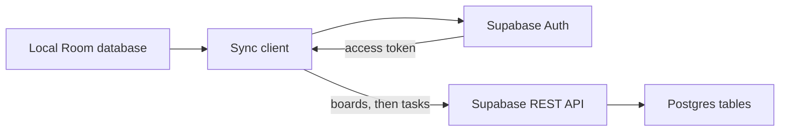

# Taskboard fixture

A fully synthetic Android task board and golden target for the android-kit tools. Boards contain shared tasks with stable status and priority identifiers. The application keeps a local Room database; its sync client targets a Supabase project configured at build time.

The sync client authenticates before sending local boards and tasks to Supabase.

## Flavors

- `clean`: baseline for correct localization, labels, and database policies.
- `defects`: deliberately broken examples. See [DEFECTS.md](DEFECTS.md) before interpreting findings. Never deploy the defect migration to a real project.

Build with JDK 21 and the Android SDK: `./gradlew assembleCleanDebug assembleDefectsDebug assembleCleanDebugAndroidTest testCleanDebugUnitTest`. CI also runs lint. `e2e/maestro` contains three passing journeys for the clean flavor and one deliberately stale selector; journey tables are in `e2e/journeys`.

## Local backend

Run a local Supabase stack using the configuration in `supabase/`; apply its normal migrations and seed. The optional SQL in `supabase/defects/` is intentionally outside the normal migrations directory. Apply it separately only to a disposable local stack when testing the harness. The scheduled cleanup job requires pg_cron; task completion timestamps are maintained by a database trigger. Run `supabase/tests/task_lifecycle.sql` against the seeded database to check completion transitions and constraints. Supply the endpoint and anon key via the Gradle build configuration. Debug builds allow an endpoint and key override from Settings, with cleartext restricted to `10.0.2.2` and `localhost`; release builds ignore the override and require HTTPS. Do not embed service-role keys in the application.

The app and data are synthetic; do not point this fixture at real projects or accounts.
